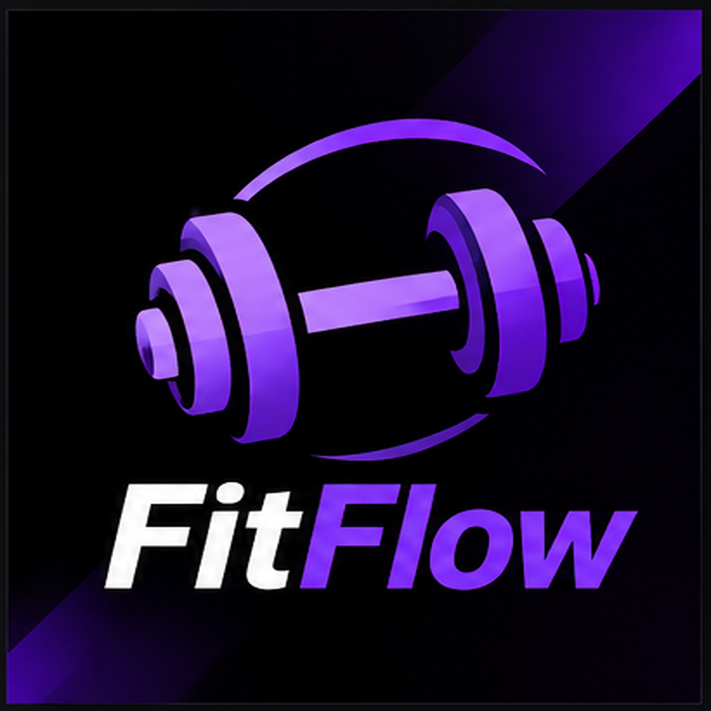

# FitFlow — Treine. Controle. Evolua.

Aplicativo mobile de demonstração para diário de treinos e acompanhamento nutricional, desenvolvido com React, TypeScript, Vite e Capacitor.



## Sobre o aplicativo
O FitFlow reúne em uma interface simples:
- **Diário de treinos:** registro de atividades e duração.
- **Controle nutricional:** área de acompanhamento alimentar e de calorias.
- **Progresso:** resumo de atividade e metas diárias.

> Os números exibidos na demonstração são ilustrativos e podem ser personalizados.

## Identidade visual
- Nome: FitFlow
- Conceito: disciplina, movimento e evolução.
- Paleta: roxo `#8B35E8`, lilás `#B98AFF`, preto `#0F0F11` e branco.
- `assets/icon.png`: 1024 × 1024 px.
- `assets/splash.png`: 2732 × 2732 px.

## Tecnologias
React · TypeScript · Vite · Capacitor · Android · GitHub Actions

## Como executar
Requisitos: Node.js 22 (ou versão LTS compatível), npm e Android Studio para executar em dispositivo Android.

```bash
npm install
npm run dev
```

## Gerar os recursos nativos Android
Na raiz do projeto:

```bash
npm install
npx capacitor-assets generate --android
npx cap add android
npm run build
npx cap sync android
npx cap open android
```

Se a pasta `android/` já existir, pule `npx cap add android`. Conecte um celular com depuração USB ativada ou use um emulador no Android Studio.

## Gerar APK pelo GitHub Actions
1. Crie um repositório no GitHub e envie todos os arquivos para `main` ou `master`.
2. Abra a aba **Actions** do repositório.
3. Selecione **Construir APK Android (Capacitor)**.
4. Aguarde o workflow terminar com status **Success**.
5. Baixe `meu-aplicativo-apk` na seção **Artifacts** da execução.

O workflow está em `.github/workflows/android-build.yml`.

## Estrutura
```text
FitFlow/
├── assets/
│   ├── icon.png
│   └── splash.png
├── src/
│   ├── App.tsx
│   ├── main.tsx
│   └── style.css
├── .github/workflows/android-build.yml
├── capacitor.config.ts
├── index.html
├── package.json
├── tsconfig.json
└── vite.config.ts
```

## Entrega da atividade
- Projeto com código atualizado.
- Arquivos fonte de ícone e splash screen.
- Workflow do GitHub Actions.
- README com detalhes do aplicativo.

**Importante:** este pacote contém o projeto-fonte e a automação. O APK só será gerado depois de instalar as dependências, criar/sincronizar a plataforma Android e executar o workflow. O print do app instalado no celular também precisa ser feito no seu próprio dispositivo ou emulador.
